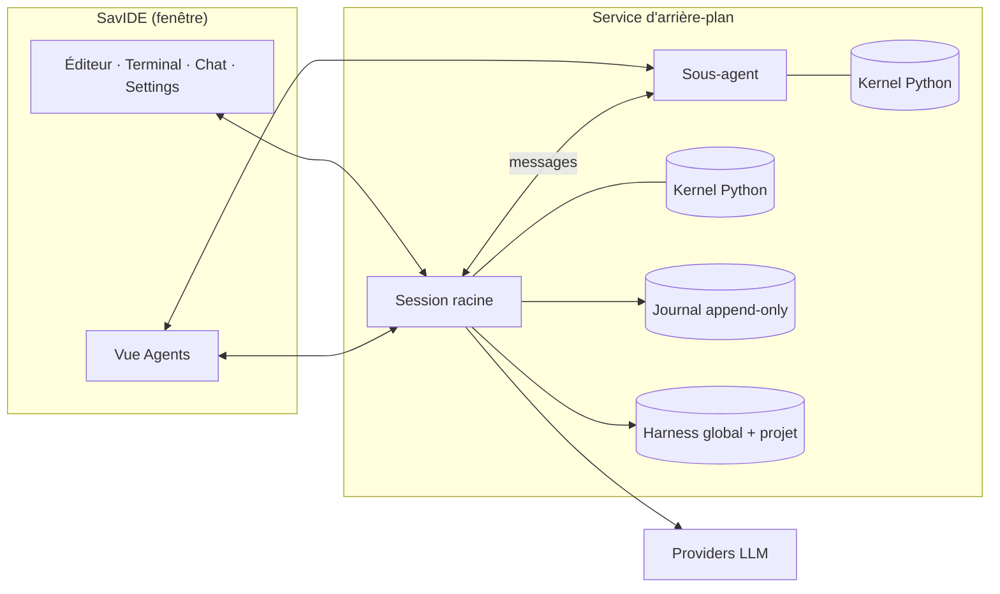

<p align="center">
  
</p>

<h1 align="center">SavIDE</h1>

<p align="center">
  <b>IDE à agent IA, édition locale (Windows, Linux, macOS).</b><br/>
  Éditeur, terminal, chat et rollback ; REPL Python persistant, harness auto-évolutif<br/>
  et sessions qui survivent à la fermeture de l'IDE, inspirés de Prime Agent.
</p>

<p align="center">
  <code>tauri 2</code> · <code>react</code> · <code>rust</code> · <code>python / ipython</code> · <code>monaco</code> · <code>xterm</code> · <code>mcp</code>
</p>

---

> SavIDE (édition locale d'Axecode) est un **fork figé** d'un IDE open source sous licence MIT (voir [Licence](#licence)). Le cordon est coupé : plus aucune
> synchronisation avec l'amont. La boucle d'agent, les outils, les modes et les providers sont désormais maintenus ici.

## Sommaire

- [Ce que fait SavIDE](#ce-que-fait-savide)
- [Architecture](#architecture)
- [Commandes de session](#commandes-de-session)
- [Providers](#providers)
- [Thème](#thème)
- [Installation](#installation)
- [Service distant](#service-distant)
- [Mises à jour et releases](#mises-à-jour-et-releases)
- [Compiler depuis les sources](#compiler-depuis-les-sources)
- [Identifiants OAuth](#identifiants-oauth)
- [Licence](#licence)

---

## Ce que fait SavIDE

| Sujet | Décision |
|---|---|
| Cerveau | Prime Agent pur : le modèle n'a qu'un outil, exécuter du code dans un kernel IPython persistant. Fichiers, shell, web, images, contexte, sous-agents, harness, MCP et skills sont des modules Python préchargés. |
| Python | Embarqué dans l'installeur (sidecar) avec IPython préinstallé. |
| Sessions | Un service d'arrière-plan lancé par l'IDE possède les sessions et leurs kernels. Fermer la fenêtre ne tue rien ; rouvrir l'IDE retrouve les sessions en cours, inactives ou archivées. |
| Journal | Append-only : chaque message, appel REPL, résultat, changement de modèle et compaction est écrit au moment où il se produit. Branches et forks déplacent un pointeur ; `/tree` montre tout. |
| Harness | Notes de prompt, mémoires, skills (paquets Python importables) et spécifications de sous-agents, en portée **globale** et **projet**, stockés en Markdown éditable à la main. `/refine` relit la trajectoire courante, applique la plus petite modification utile, la journalise avec sa preuve et permet le rollback par identifiant. |
| Sous-agents | Persistants, créés depuis le REPL, messagerie limitée à la famille nucléaire. La vue Agents remplace le panneau swarm. |
| Settings > Outils | Chaque module et chaque fonction exposés dans le REPL ont un interrupteur et une description éditable. Ce qui est désactivé n'existe ni dans le kernel ni dans le prompt. |

---

## Architecture



- **`src/`** — UI React (Monaco, xterm, chat, settings, arbre de fichiers). `src/axe/` porte l'identité et le thème Axe.
- **`src-tauri/`** — coque Tauri 2, commandes IPC, I/O workspace, attachement au service.
- **`crates/axecode-core`** — types indépendants du provider : messages, outils, flux, modèles.
- **`crates/axecode-app`** — boucle d'agent REPL, compaction, rollback, MCP.
- **`crates/axecode-daemon`** — service d'arrière-plan, journal, cycle de vie des sessions et kernels.
- **`crates/axecode-harness`** — harness continual (notes, mémoires, skills, sous-agents) et `/refine`.
- **`crates/axecode-{anthropic,openai,google,kimi,openrouter,…}`** — adaptateurs providers.

---

## Commandes de session

| Commande | Effet |
|---|---|
| `/goal` | Objectif persistant re-présenté à chaque tour avec sa progression, budget de jetons optionnel. |
| `/autonomous` | Continuation automatique vers l'objectif, bornée par tours / jetons / durée, avec gate de qualité optionnelle. Atteindre une limite n'est jamais présenté comme un succès. |
| `/heartbeat` | Message périodique injecté dans la session. |
| `/compact` | Compaction manuelle avec directive optionnelle. |
| `/refine` | Refinement du harness à partir de la trajectoire courante. |
| `/tree` | Historique complet du journal, retour à n'importe quel point. |
| `/login`, `/settings` | Connexion provider, ouverture des réglages. |

---

## Providers

Les cinq providers d'origine et leurs flux OAuth (Anthropic, OpenAI, Google via Antigravity, Kimi, OpenRouter), plus :

- **OpenAI-compatible** et **Anthropic-compatible** personnalisés, autant d'instances qu'on veut (Ollama, LM Studio, vLLM, Together, Azure, proxies…).
- Adaptateurs natifs **Mistral**, **DeepSeek**, **xAI**, **Groq**, **Prime Inference**.
- Détection automatique d'**Ollama** et **LM Studio** locaux.
- Surcharge de fenêtre de contexte par modèle ; changement de modèle en cours de session ; indicateur de quota d'abonnement dans la barre d'état.

---

## Thème

Settings > Apparence propose un sélecteur de couleur de fond libre. Les teintes secondaires (panneaux, bordures, texte)
sont dérivées automatiquement de la luminance choisie pour rester lisibles ; l'orange Axe `#fc610b` reste la couleur
d'accent. Un bouton « Revenir au défaut Axe » restaure le thème d'origine. Le choix survit au redémarrage.

---

## Installation

Téléchargez le fichier de votre système dans la dernière release :
https://github.com/SavinienD/-SavIDE/releases/latest

| Système | Fichier |
| --- | --- |
| Windows x64 | `SavIDE_X.Y.Z_x64-setup.exe` (NSIS) |
| Linux x64 | `SavIDE_X.Y.Z_amd64.deb` (Debian, Ubuntu) ou `SavIDE_X.Y.Z_amd64.AppImage` (`chmod +x` puis lancer) |
| macOS (Intel et Apple Silicon) | `SavIDE_X.Y.Z_universal.dmg` |

L'application n'est signée ni par Microsoft ni par Apple :

- Windows : SmartScreen affiche « éditeur inconnu » (« Informations complémentaires » puis « Exécuter quand même »).
- macOS : Gatekeeper refuse d'ouvrir une appli non notariée. Après l'avoir glissée dans Applications, faites
  clic droit (ou Ctrl-clic) sur SavIDE > Ouvrir, puis Ouvrir, une seule fois. Si macOS dit que l'appli est
  « endommagée », retirez l'attribut de quarantaine : `xattr -dr com.apple.quarantine /Applications/SavIDE.app`.

L'application se met ensuite à jour seule depuis ces releases (installeur Windows, AppImage, appli macOS ;
le paquet `.deb` se met à jour en réinstallant le nouveau `.deb`).

---

## Service distant

Le service d'arrière-plan peut tourner sur une autre machine ; l'IDE s'y connecte depuis **Settings > Connexions** (connexion distante en WebSocket ou par tunnel SSH). L'écoute réseau est **fermée par défaut** ; hors loopback, le service refuse de démarrer sans identifiants et vérifie l'en-tête `Host`. Commandes du binaire (`SavIDE.exe`) :

```text
SavIDE.exe --daemon set-password --user axe     # mot de passe lu sur stdin (ou AXECODE_PASSWORD)
SavIDE.exe --daemon token --label laptop        # affiche un jeton une seule fois
SavIDE.exe --daemon serve --listen 127.0.0.1:9119 --allow-host axe.example.com
```

Exposez-le derrière un reverse proxy HTTPS plutôt que directement.

---

## Mises à jour et releases

L'updater Tauri lit `https://github.com/SavinienD/-SavIDE/releases/latest/download/latest.json`
(`plugins.updater.endpoints` dans `src-tauri/tauri.conf.json`) et n'accepte que des installeurs signés par la clé
publique de ce même fichier (`plugins.updater.pubkey`). La clé privée n'est jamais dans le dépôt (`*.key` ignoré par git) ;
elle est stockée dans les secrets GitHub du dépôt `TAURI_SIGNING_PRIVATE_KEY` et `TAURI_SIGNING_PRIVATE_KEY_PASSWORD` (vide).
Si elle est perdue, les postes installés ne pourront plus se mettre à jour et devront réinstaller.

Publication : poser la version puis pousser un tag `vX.Y.Z` ; le workflow `.github/workflows/release.yml` construit
Windows (NSIS), Linux (.deb, AppImage) et macOS (universal : .dmg, .app.tar.gz), signe les artefacts de mise à jour,
fusionne `latest.json` (windows-x86_64, linux-x86_64, darwin-x86_64, darwin-aarch64) et crée la release. Détails : [docs/publier.md](docs/publier.md).

---

## Compiler depuis les sources

```powershell
# Windows : Rust 1.80+ (MSVC), Node 20+, Build Tools C++ ; voir docs/BUILD-INSTALLEUR.md
npm install
npm run tauri dev      # développement
npx tauri build --bundles nsis --config src-tauri/tauri.sidecars.conf.json --config src-tauri/tauri.build-local.json
```

Vérifications rapides :

```powershell
cargo check --workspace
npm run build          # tsc --noEmit && vite build
```

Régénérer le jeu d'icônes depuis le logo :

```powershell
node scripts/generate-savide-icon.mjs
npx tauri icon src-tauri/icons/savide-icon-1024.png
```

Le dépôt est un workspace Cargo (`crates/*` + `src-tauri/`) plus un frontend Vite + React (`src/`).

---

## Identifiants OAuth

Les client IDs OAuth des providers (et le client secret Google) sont embarqués dans les sources, comme le font les
« installed applications » (`gcloud`, etc.). Ils ne sont pas considérés comme secrets dans ce contexte. Le fork ne se
synchronisant plus avec l'amont, c'est à nous de suivre les évolutions des clients officiels Anthropic / OpenAI / Google.

---

## Licence

[MIT](./LICENSE) — SavIDE est dérivé d’un projet libre sous licence MIT ; la notice de copyright d’origine est conservée telle quelle dans [LICENSE](./LICENSE).
